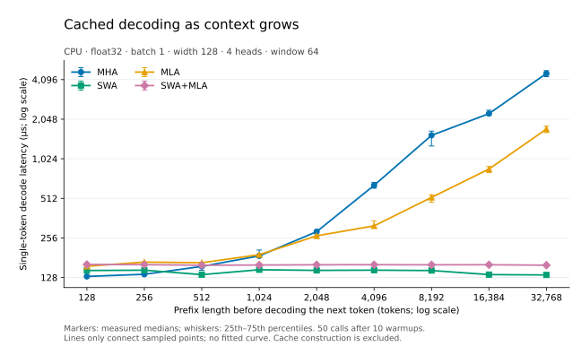

# Hybrid Sliding Window and Multi-head Latent Attention

A minimal PyTorch implementation of a **hybrid attention mechanism combining Sliding Window Attention (SWA) and Multi-head Latent Attention (MLA)**, developed as a take-home assignment for the Junior AI Research Engineer position at Domyn.

The goal is to implement the mechanisms faithfully, verify their mathematical correctness, and compare their **KV-cache footprint and single-token decoding latency** against standard Multi-Head Attention (MHA). The project prioritizes clarity and reproducibility over production-level optimization.

## Attention variants

| Variant | Attention scope | KV cache |
| --- | --- | --- |
| **MHA** | All previous tokens (causal) | Full per-head Keys and Values |
| **SWA** | Most recent `W` tokens | Window of full per-head Keys and Values |
| **MLA** | All previous tokens (causal) | Shared compressed KV latents and positional Keys |
| **SWA + MLA** | Most recent `W` tokens | Window of compressed KV latents and positional Keys |

The hybrid combines two complementary ideas: **SWA limits how many positions each query can attend to; MLA reduces how much information must be cached per position**. All four variants are implemented using two attention modules (`MHA` and `MLA`), each with an optional sliding-window size.

## Implementation

### Sliding Window Attention

For a query at position `t`, a window of size `W` permits attention only to Key positions `j` satisfying:

```text
max(0, t - W + 1) <= j <= t
```

The current token counts toward the window. With `W=1`, a token attends only to itself; with `W` at least as large as the sequence, SWA is equivalent to full causal attention. The full-sequence implementation uses a **dense local causal mask** for simplicity and correctness.

### Multi-head Latent Attention

MLA follows **DeepSeek-V2, Section 2.1**. Instead of storing full historical Keys and Values, it learns a shared low-rank KV representation `c_kv`. Query compression is also implemented.

To preserve relative positional information without losing the benefits of KV compression, **Decoupled RoPE** separates content and positional components. Each head has its own positional Query, while the positional Key is shared across heads:

```text
c_kv[t] = W_DKV x[t]                         # shared KV latent
c_q[t]  = W_DQ  x[t]                         # shared Query latent

q_content[t,i] = W_UQ[i] c_q[t]
k_content[t,i] = W_UK[i] c_kv[t]
v[t,i]         = W_UV[i] c_kv[t]

q_position[t,i] = RoPE_t(W_QR[i] c_q[t])
k_position[t]   = RoPE_t(W_KR x[t])          # shared across heads

score[t,j,i] = (
    dot(q_content[t,i], k_content[j,i])
    + dot(q_position[t,i], k_position[j])
) / sqrt(head_dim + rope_dim)
```

The two score contributions are added **before a single Softmax**. Keeping RoPE out of the content Keys is essential for efficient compressed-cache decoding.

### Compressed KV-cache decoding

Both attention modules provide the same inference interface:

```python
output, cache = model.decode(token, cache)  # cache=None for the first token
```

Here `token` and `output` have shape `(batch, 1, d_model)`. Each call returns a new cache without mutating the previous one.

- **MHA/SWA** store rotated Keys and unrotated Values, each with shape `(B, H, N, d)`.
- **MLA/hybrid** store only a shared KV latent `(B, N, r)` and a shared rotated positional Key `(B, N, R)`; no historical full K/V or Query latents are cached.
- **Windowed variants** retain at most `W` positions. Absolute RoPE positions continue increasing after older entries are evicted.

For each head, MLA avoids reconstructing historical content Keys and Values using these equivalent rearrangements:

```text
q^T (W_UK c_j)          = (W_UK^T q)^T c_j
sum_j a_j (W_UV c_j)   = W_UV (sum_j a_j c_j)
```

Thus the Key up-projection moves to the current Query, and the Value up-projection is applied **after** aggregating the cached latents. The attention scaling remains `1 / sqrt(head_dim + rope_dim)`.

The decoder uses simple cache concatenation and trimming; it does **not** use a preallocated circular buffer.

## Results

The following results come from one recorded **CPU float32, single-token decoding** run on an **Apple M1 MacBook Air (8 GB RAM)**. Settings: `d_model=128`, `num_heads=4`, `kv_rank=32`, `q_rank=64`, `rope_dim=16`, batch size 1, and a **512-token prefix**. Windowed variants use `W=64`; times are medians over 50 measured calls after 10 warmups.

| Variant | Parameters | Cached tokens | KV cache (KiB) | Median decode (µs) |
| --- | ---: | ---: | ---: | ---: |
| MHA | 65,536 | 513 | 513.00 | 142.46 |
| SWA | 65,536 | 64 | 64.00 | 131.75 |
| MLA | 51,200 | 513 | 96.19 | 162.08 |
| **SWA + MLA** | **51,200** | **64** | **12.00** | **155.96** |

**Key observations:**

- The hybrid uses **42.75× less returned KV-cache storage than full MHA**, combining a shorter visible context with latent compression. These variants do **not** retain the same number of tokens.
- Compared with SWA alone, the hybrid uses **5.33× less cache storage at the same 64-token window**, isolating the additional benefit of MLA compression.
- The hybrid is **approximately 9.5% slower than MHA** in this CPU run. Reduced cache storage does not automatically imply reduced latency, especially with eager PyTorch operators and cache-copy overhead.

Cache measurements cover the **backing storage of returned cache tensors**, not temporary allocations, peak memory, or full process memory. These are small, untrained attention modules on synthetic inputs; the measurements do not establish language-model quality or universal speedups.

See [BENCHMARKS.md](docs/BENCHMARKS.md) for the full methodology, additional prefix lengths, theoretical operation counts, hardware information, and limitations. Raw measurements are in [`results/decode_cpu_float32.json`](results/decode_cpu_float32.json).

### Context-length experiment: fixed window of 64

A new extended run on **25 October 2026** measures prefixes of **128, 256, 512, 1,024, 2,048, 4,096, 8,192, 16,384, and 32,768 tokens**, holding `W=64` and the model dimensions above fixed. All nine lengths were measured together using CPU float32, batch size 1, one intra-op thread, 10 warmups, and 50 measured calls. Prefix-cache construction is excluded. Both plot axes are logarithmic so the short-context crossover and long-context growth remain visible. Markers and whiskers show measured medians and within-case interquartile ranges, not confidence intervals or a fitted scaling law.



**Experimental finding:** in this extended run, the hybrid first has a lower median than MHA at **1,024 tokens**: **159.29 µs versus 187.02 µs**. At 512 it remains slightly slower (**158.73 versus 155.46 µs**), so the sampled ordering reverses between 512 and 1,024. The [earlier six-length run](results/context_scaling_cpu_float32.json) first recorded a hybrid win at 2,048. This difference across runs reinforces that the experiment does **not** establish an exact or universal break-even threshold.

The added long-context cases have these measured median latencies (µs):

| Prefix tokens | MHA | SWA | MLA | SWA+MLA |
| ---: | ---: | ---: | ---: | ---: |
| 8,192 | 1,543.21 | 144.65 | 520.60 | 159.85 |
| 16,384 | 2,255.81 | 134.65 | 855.35 | 160.08 |
| 32,768 | 4,558.67 | 133.85 | 1,722.71 | 158.81 |

**Theoretical interpretation:** MHA's per-step attention work and concatenation-based cache copies grow with context; windowing bounds both by `W`. MLA reduces cached features per token but has additional projection/operator overhead, so a smaller cache need not yield lower latency at short contexts. At 32,768, returned-cache storage is **32,769 KiB for MHA versus 12 KiB for the hybrid**, which retains only 64 tokens; temporary allocations and peak memory are excluded. Windowed updates still copy `O(W)` entries, and operation counts alone cannot explain the exact latency curve. The dense full-sequence SWA path remains quadratic and is not timed here.

[Extended raw samples and complete settings](results/context_scaling_32768_cpu_float32.json) are retained separately from the previous run. Reproduce the sweep using the existing benchmark:

```bash
python3 -B benchmark.py --device cpu --dtype float32 --threads 1 \
  --d-model 128 --num-heads 4 --kv-rank 32 --q-rank 64 --rope-dim 16 \
  --batch-size 1 --window-size 64 \
  --prefix-lengths 128 256 512 1024 2048 4096 8192 16384 32768 \
  --warmup 10 --repeats 50 --seed 17 --output results/context_scaling_32768_cpu_float32.json
```

To regenerate the SVG, run the following with an interpreter that has **Matplotlib** installed (rendered here with version **3.11.1**). This is only a plotting dependency; the attention and benchmark requirements are unchanged. Keep its font cache on the SSD:

```bash
mkdir -p .cache/matplotlib
MPLCONFIGDIR="$PWD/.cache/matplotlib" python3 -B scripts/plot_context.py results/context_scaling_32768_cpu_float32.json
```

## Setup and usage

Requires Python and PyTorch. To create a local virtual environment:

```bash
python3 -m venv .venv
.venv/bin/python -m pip install -r requirements.txt
```

**Run the tests** from the repository root:

```bash
.venv/bin/python -B -m unittest discover -s scripts -p 'test_*.py' -v
```

The documented test suite contains **15 tests**, covering independent attention references, input/parameter gradients, RoPE, causal and window boundaries, full-sequence versus cached decoding, cache eviction/storage, and benchmark accounting. CPU float32 and float64 are used for numerical verification; there are no speed thresholds in the tests.

**Run the decoding benchmark** with its default CPU settings:

```bash
.venv/bin/python -B benchmark.py --output results/decode.json
```

Example of incremental decoding with the hybrid:

```python
import torch
from attention import MLA

model = MLA(64, 4, kv_rank=16, q_rank=32, rope_dim=8, window_size=4).eval()
x = torch.randn(2, 10, 64)
cache = None
outputs = []
for token in x.split(1, dim=1):
    output, cache = model.decode(token, cache)
    outputs.append(output)

decoded = torch.cat(outputs, dim=1)
torch.testing.assert_close(decoded, model(x), rtol=1e-4, atol=1e-6)
```

The `forward()` method processes complete sequences and is differentiable; `decode()` handles one token at a time with autograd disabled. A separate cache-producing parallel prefill API is not implemented.

## Scope and limitations

This implementation emphasizes **mathematical correctness, understandable code, and reproducible measurements** rather than production performance.

- **Dense SWA forward:** the full-sequence path masks out-of-window positions but still computes a dense attention matrix, retaining quadratic score computation and storage. Only the cached single-token decoder limits the number of attended positions directly.
- **MLA execution paths:** the differentiable full-sequence path expands content K/V from latents; cached decoding operates directly on compressed representations.
- **Cache update overhead:** concatenation and trimming copy data. Returned windowed caches stay bounded, but updates are not constant-time and temporary allocations are not captured by cache-payload measurements.
- **Controlled comparison:** model width and head count are held fixed, but MLA has different query/key projection dimensions and parameter counts. The results are not equal-parameter or equal-FLOP benchmarks.
- **Scope:** this is an attention-mechanism implementation, not a reproduction of the full DeepSeek-V2 or Mistral models. It does not implement sparse attention kernels, long-context RoPE scaling, padding masks, MoE, or language-model quality evaluation.

## References

- [Mistral 7B — Sliding Window Attention](https://arxiv.org/abs/2310.06825)
- [DeepSeek-V2 — MLA, Section 2.1 and Appendix C](https://arxiv.org/abs/2405.04434)
- [RoFormer — Rotary Position Embeddings](https://arxiv.org/abs/2104.09864)
- [nanoGPT](https://github.com/karpathy/nanoGPT) — suggested minimal Transformer reference; no nanoGPT code is included in the current attention implementation.
